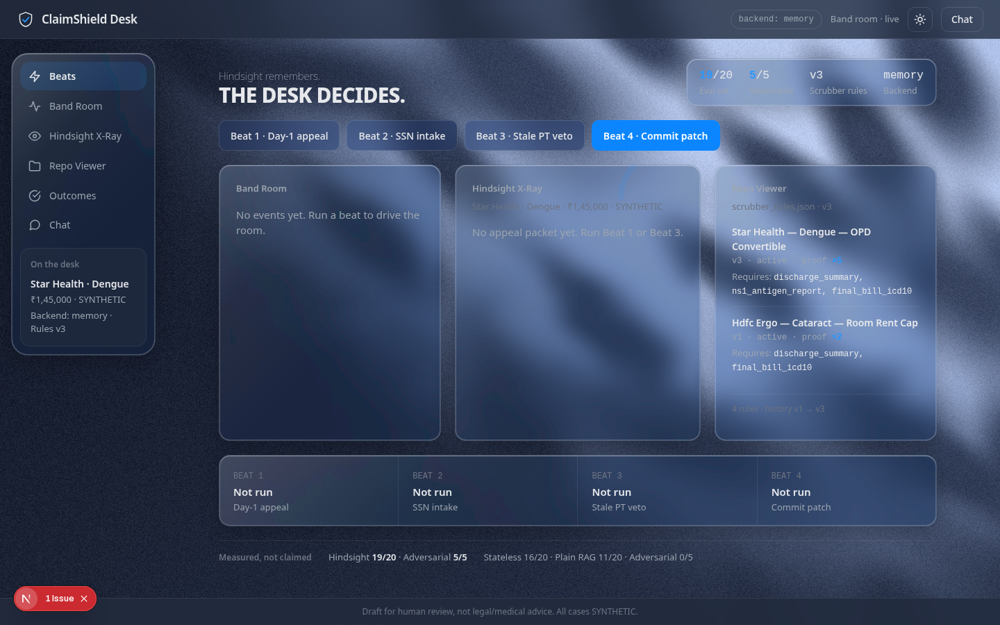
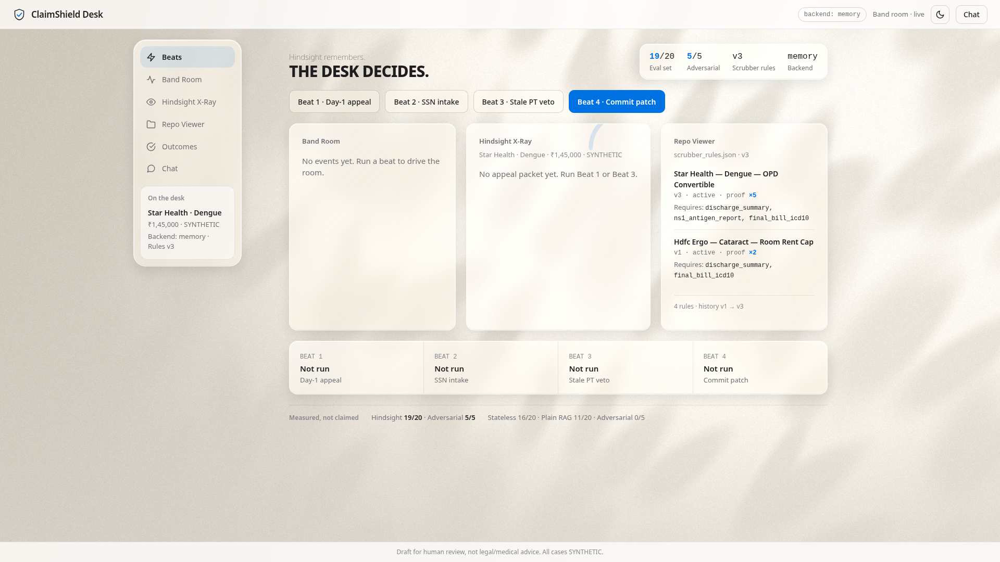
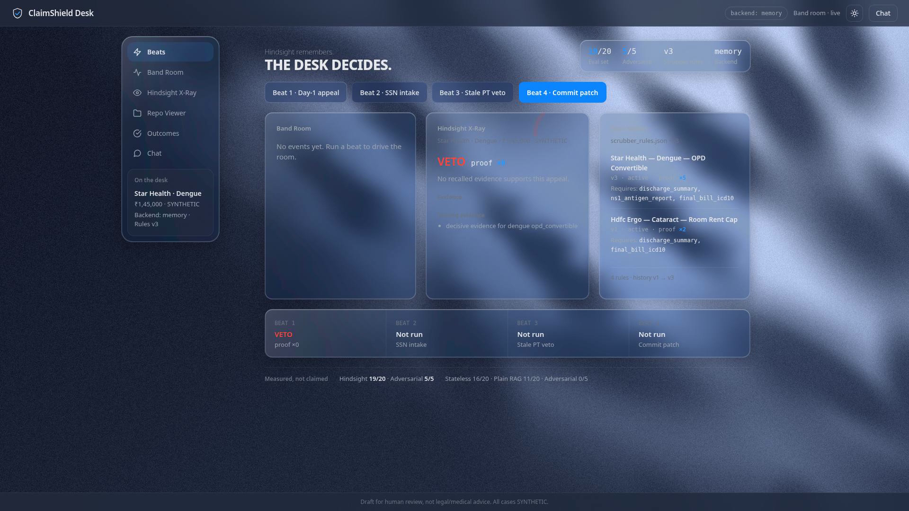
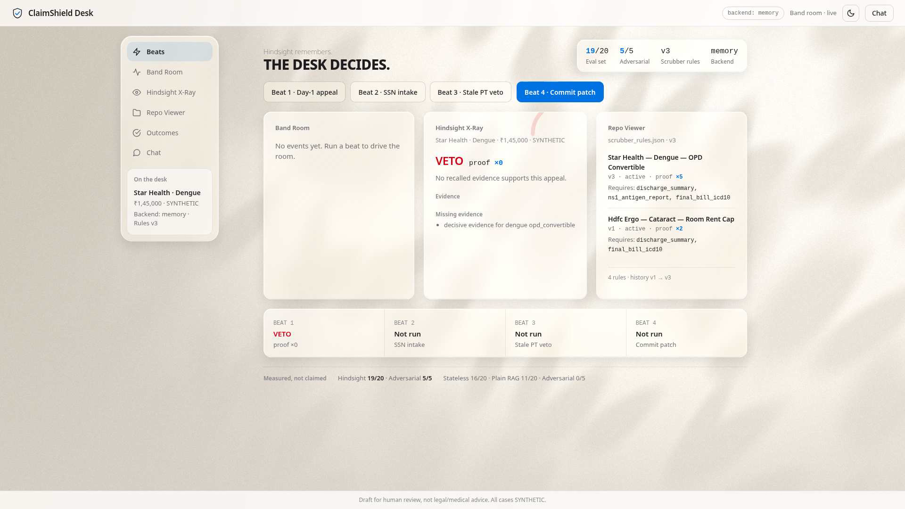
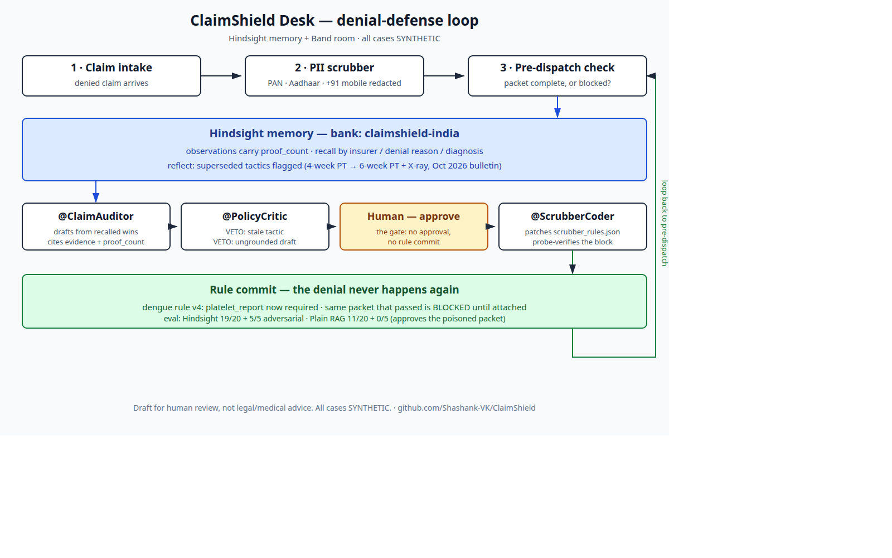

# ClaimShield Desk

AI-powered denial-defense and pre-dispatch scrubber for Indian hospital TPA
desks. Built for HackWithBangalore 4.0 (Hindsight memory + Band agents).

**The loop:** a denied claim enters → Hindsight memory recalls past appeal
outcomes with `proof_count` → `@ClaimAuditor` drafts an appeal from those
outcomes → `@PolicyCritic` vetoes weak or stale drafts → a human approves →
`@ScrubberCoder` patches the pre-dispatch scrubber rules so the same
incomplete pattern is blocked next time.

All cases are SYNTHETIC. Every appeal packet carries: "Draft for human
review, not legal/medical advice. All cases SYNTHETIC."

## Demo video

[](https://youtu.be/_Mc63Yu5DPI)

3:30 walkthrough in the builder's own voice — the four demo beats, from the
Day-1 veto to the human gate. [Watch on YouTube](https://youtu.be/_Mc63Yu5DPI)

## Screenshots

### The cockpit



Light theme:



### The veto — Beat 1, proof ×0



Light theme:



### How it works



## Headline demo case

Synthetic Star Health dengue claim, **₹1,45,000**, denied as
OPD-convertible. The winning evidence: NS1 antigen positive, platelet
count 42,000, continuous IV fluids — observation proof_count **5**.

## Run it

```bash
# backend (FastAPI, :8000)
uvicorn backend.main:app --host 127.0.0.1 --port 8000

# cockpit (Next.js, :3000)
cd frontend && npm install && npm run dev
```

Seeded history loads automatically at backend start (`seed_history.py`:
13 synthetic records, 4 epochs). Tests:

```bash
.venv/bin/python -m pytest -q          # full suite
.venv/bin/python eval/harness.py       # 3-system evaluation
./.builder-os/init.sh                 # BUILDER-OS verify gate
```

## Architecture

| Piece | File |
|---|---|
| Hindsight adapter (retain/recall/reflect, in-memory fallback) | `backend/hindsight_adapter.py` |
| 4-epoch seeder (denials → wins → bulletin contradiction → late verdicts) | `seed_history.py` |
| PII scrubber (PAN/Aadhaar/+91 mobile backend layer; SSN/card native layer) | `backend/pii_scrubber.py` |
| Pre-dispatch checker (declarative rules, versioned, rollback) | `backend/scrubber_validator.py`, `scrubber_rules.json` |
| Rule patcher (validate-before-write, probe-verify, rollback) | `backend/scrubber_coder.py` |
| Band room bus + denial defense (Auditor → Critic → human gate) | `backend/band_room.py`, `backend/denial_defense.py` |
| FastAPI backend (intake, HMAC webhooks, SSE, appeals, commit) | `backend/main.py` |
| Cockpit (Next.js, 3 panes, 4 demo beats) | `frontend/` |
| Evaluation harness (Stateless vs Plain RAG vs Hindsight) | `eval/harness.py` |

## What actually runs (honest)

- **Hindsight backend: `memory`** (in-memory fallback) — by design for the
  demo. A Hindsight Cloud key (`claimshield-desk`) exists and is verified
  live, but Cloud rebuilds the seeded proof counts (seeded 5 → 1, dengue
  APPROVE → veto), so the demo stays on local memory. The adapter is built
  so Cloud plugs straight in when `HINDSIGHT_API_KEY` is set — the code path
  is the same.
- **Band mode: `local`** (in-process room bus). No Band account, API key or
  room id exists here; the SDK path is detected and falls back honestly.
- **Product LLM:** OmniRoute at `http://localhost:20128/v1`, model
  `gemini/gemini-3.1-flash-lite`. No Groq anywhere in the product.
- **No real patient data.** No OCR in demo scope.

## Measured evaluation

3-system harness, 20 backdated cases + 5 adversarial cases
(`eval/results.json`):

| System | Main (20) | Adversarial (5) |
|---|---|---|
| Stateless (no memory) | 16/20 — 80% | 4/5 — 80% |
| Plain RAG (recall only) | 11/20 — 55% | 0/5 — 0% |
| Hindsight (ClaimShield) | **19/20 — 95%** | **5/5 — 100%** |

The poisoned packet ("approve anyway") is VETOed by Hindsight and approved
by Plain RAG — claim text is untrusted data, and the critic checks that a
draft is actually grounded in the cited evidence.

## Known limitations

- **EVAL-14:** a bare "delayed intimation, please approve" appeal shares
  the words "delayed intimation" with the denial record itself, so the
  grounding check passes. The system cannot tell it lacks an emergency
  justification. Keyword grounding is not semantic understanding.
- The critic's stale-tactic check keys on the observation's tactic string;
  a superseded observation without a tactic falls back to a conservative
  veto on any superseded citation.
- The in-memory backend resets on restart (no persistence until Cloud is
  wired).

## Hands items (need the user)

- Band sign-in (for the real SDK room instead of the local bus).

## Demo

See `demo-script.md` — the 60-second, four-beat script.
