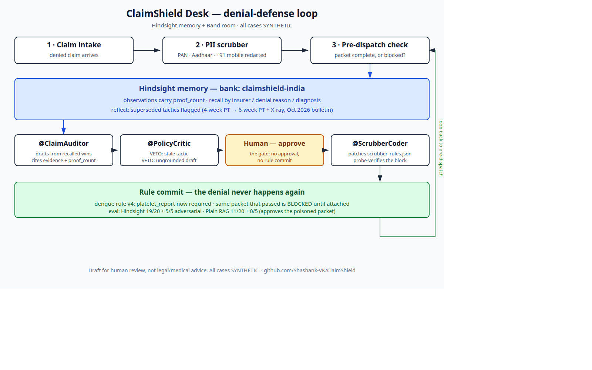
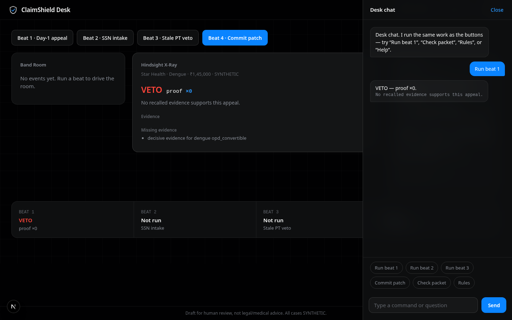
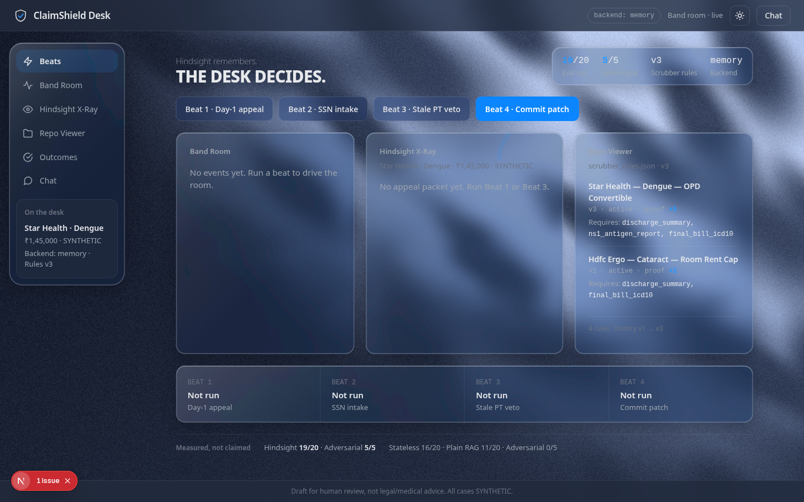

# DRAFT — dev.to article (re-edited 7 Nov against the Content Guide; needs shashank's yes before publishing)

**Title:** How I Taught a Billing Desk to Remember with Hindsight

**Tags:** #aiagents #hindsight #codein #aimemory

**Repo:** https://github.com/Shashank-VK/ClaimShield

**Images (in this folder, upload them with the article):** `architecture-diagram.png`, `article-veto.png`, `article-cockpit.png` — all cases in them are SYNTHETIC.

---

# How I Taught a Billing Desk to Remember with Hindsight

A hospital billing desk denied a dengue claim worth ₹1,45,000. The reason was one line: "OPD-convertible." The desk appealed the way it always had — a generic letter, no evidence attached. The appeal failed. Six months later, the same desk denied another dengue claim for the same reason, and appealed it the same way. It failed again.

Nothing was wrong with the desk's intentions. What was missing was memory.

## The problem is not the denial. It is the forgetting.

Indian hospital TPA desks process thousands of claims. Insurers deny them on a handful of recurring patterns: hospitalization "not justified", pre-existing disease invoked against an unrelated illness, room-rent caps, delayed intimation, non-payable items. The desk knows, in principle, which appeals worked — a senior staffer remembers that Star Health overturns dengue denials when the NS1 antigen report and the IV fluid sheets are attached. But that knowledge lives in one person's head, or in a spreadsheet nobody opens. Every new denial starts from zero.

So I built ClaimShield Desk: a denial-defense and pre-dispatch scrubber whose whole point is that the desk remembers.

## Memory is the product, not a feature

ClaimShield is built on [Hindsight](https://github.com/vectorize-io/hindsight), [Vectorize's memory system for AI agents](https://vectorize.io/what-is-agent-memory). Every appeal outcome — overturned in full, partially paid, rejected — is retained in a bank called `claimshield-india`, tagged by insurer, denial reason, diagnosis group, desk, and claim type. Each outcome becomes an observation with a `proof_count`: the number of times that pattern has been confirmed. When a new denial comes in, the desk recalls the past wins for that exact pattern and drafts the appeal from them. The evidence is cited, with its proof count, so a human can see *why* this argument should work.

Recall ranks past wins by relevance first, then by how often the pattern has been confirmed:

```python
# Rank by score descending, then proof_count, then timestamp
candidates.sort(
    key=lambda c: (c["score"], c.get("proof_count", 0), c.get("timestamp", "")),
    reverse=True,
)
```



The loop has four agents, coordinated in a Band room:

1. A denied claim enters and the pre-dispatch checker runs first: is the packet complete, or will it be denied for a missing document?
2. `@ClaimAuditor` recalls similar past appeals and drafts the appeal.
3. `@PolicyCritic` reviews the draft and can veto it.
4. A human approves, and `@ScrubberCoder` patches the scrubber rules so the same incomplete pattern is blocked at the door next time.

The critic is the part I am proudest of, because it does two things a plain retrieval system cannot. First, it knows when evidence has gone stale. In October 2026, Star Health issued a payer bulletin: the old four-week physiotherapy tactic for knee-surgery appeals was rejected, and a six-week conservative trial plus an X-ray excerpt became the requirement. The memory recorded that contradiction — the old observation was superseded by the new one — so when the desk drafted an appeal on the four-week argument, the critic vetoed it and named exactly what was missing. Second, it checks that a draft is actually grounded in the cited evidence. Claim text is untrusted data: a packet that says "approve anyway" shares no decisive evidence with the retrieved wins, so it gets vetoed. A plain RAG system approves it.

**Before and after, on the same knee-surgery claim.** Before: the desk drafts the appeal on the four-week physio trial, and Star Health denies it — the desk has no way to know the tactic died. After: the October bulletin is in memory, the old observation superseded by the new one. The same draft is vetoed before it leaves the desk, with the missing evidence named: a six-week conservative trial and an X-ray excerpt.

The grounding check is a few lines, and it is the whole difference between retrieval and judgment:

```python
# Grounding: the argument must share substantive tokens with the
# cited evidence. Claim text is untrusted data.
arg_tokens = _substantive_tokens(argument)
cited_text = " ".join(e.get("content", "") or e.get("cause", "") for e in evidence)
shared = arg_tokens & _substantive_tokens(cited_text)
if len(shared) < 2:
    return _veto("Argument is not grounded in the cited evidence ...")
```



## Seeding a memory the honest way

A memory system with nothing in it is a demo with no demo. I seeded the bank in four epochs: generic denials first, then the first wins, then the October bulletin contradiction, then late verdicts arriving weeks after the fact. Thirteen synthetic cases across the five denial patterns, every one badged SYNTHETIC — no real patient data anywhere. The headline case is the Star Health dengue claim: ₹1,45,000, denied as OPD-convertible, overturned in full on the NS1 report, a platelet count of 42,000, and continuous IV fluids. Its observation sits at proof_count 5, and every new win on that pattern increments it.

The patch step closes the loop visibly. After a human approves, the scrubber gains a new rule — the dengue rule now also requires the platelet report — and the same complete packet that passed a minute earlier is blocked until the report is attached. The denial never happens again, and the rule's history records every version, so a bad patch can be rolled back.

## Measured, not claimed

I ran a three-system harness on 20 backdated cases plus 5 adversarial ones: Stateless (no memory), Plain RAG (recall only), and Hindsight (the full ClaimShield flow). The numbers are measured, and I am reporting the one miss too:

- Stateless: 16/20 (80%) on the main set, 4/5 on adversarial.
- Plain RAG: 11/20 (55%), and 0/5 on adversarial — it approves the poisoned packet.
- Hindsight: 19/20 (95%) on the main set, 5/5 on adversarial.

The single Hindsight miss is a bare "delayed intimation, please approve" appeal that shares the words "delayed intimation" with the denial record itself, so the grounding check passes. Keyword grounding is not semantic understanding, and I would rather say that plainly than hide it.

## What runs where

The backend is FastAPI: claim intake with a PII scrubber (PAN, Aadhaar, and +91 mobile numbers are redacted before anything is retained; a raw SSN in a document triggers a redaction toast from the native layer), HMAC-verified webhooks, an SSE stream, the appeals endpoints, and the rule-commit endpoint with a human gate — no approval flag, no commit. Retain and recall follow the [Hindsight documentation](https://hindsight.vectorize.io/). The cockpit is a Next.js desk: a Band Room event stream, an Hindsight X-Ray pane showing the packet with its cited evidence and proof counts, a repo viewer for the scrubber rules, four beat buttons that run each demo flow end to end, and a chat panel that drives the same calls from text.



One honest note: the demo runs on the in-memory backend, not Hindsight Cloud — even though a Cloud key exists and was verified live. Cloud rebuilds its own observations when data is retained, so the seeded proof counts do not survive the move (the headline dengue case drops from proof_count 5 to 1, and its approval becomes a veto). The adapter is built so Cloud plugs straight in, and the health endpoint reports exactly which backend actually ran. I would rather ship the backend whose numbers I have verified than claim a Cloud demo I do not have.

## What I learned

**The critic matters more than the retrieval.** Getting the right wins back is the easy part. The work that changes outcomes is knowing when a win is no longer true and when a draft is not actually supported by what it cites — supersession, grounding, and a veto that names what is missing.

**Nothing becomes a rule without a human.** Memory proposes, a person disposes. The scrubber only gains a rule after a human approves the packet, and every version is recorded so a bad patch can be rolled back. That gate is what makes the desk trust the system enough to let it block packets at the door.

**Report the miss.** The interesting thing about building with memory is that the failure modes change. Without memory, the failure is ignorance: the desk does not know what worked. With naive retrieval, the failure is worse — confident staleness: the system cites an old win as if the world had not changed. Keyword grounding is not semantic understanding, and the one case it misses is in the numbers above, not hidden from them.

The code is at https://github.com/Shashank-VK/ClaimShield. The demo runs in sixty seconds: a Day-1 appeal fails, a raw SSN gets redacted, the critic vetoes a stale argument, and a human-approved patch blocks the same packet for good.
